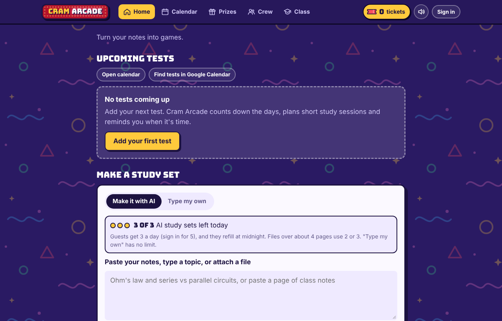
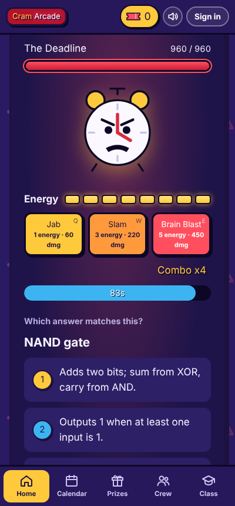
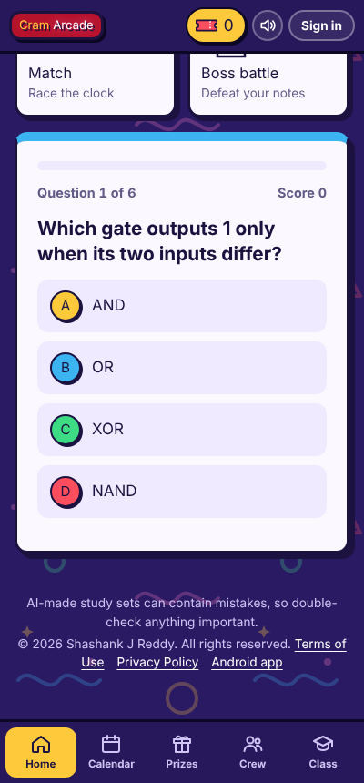

# Cram Arcade

**Turn your notes into games.** Paste class notes, attach a PDF, Word file or photo, or just
say a topic out loud, and Cram Arcade uses AI to build flashcards, a quiz, a matching game and
a boss battle from it. Students earn arcade tickets for real studying, teachers see which
questions their class keeps missing, and a calendar plans study sessions before each test.

**Live site:** https://cram-arcade.vercel.app &nbsp;·&nbsp; **Android app:** download it from the site on any Android phone

<p>
  
  
</p>

## Why I built it

Studying from notes is boring, so most people re-read instead of testing themselves, even
though self-testing works much better. Cram Arcade makes the testing part feel like an
arcade: the more questions you actually answer, the more you win.

## Features

**Making a study set**
- **AI study sets** from pasted notes, a topic, a **PDF**, a **Word document**, **photos** of
  handwritten notes, or **voice**. The number of flashcards grows with how much material you
  give it (10 for a short topic, up to 40 for a long chapter), so long documents aren't
  squeezed into a few cards.
- **Type your own set** for free (no AI): add cards one by one or paste a list
  (`term - answer`, one per line; Quizlet exports work).
- Every set is saved, and syncs across devices when you sign in with Google.

**Studying it**
- **Flashcards** you can flip, shuffle and sort into "got it" and "still learning".
- **Multiple-choice quiz** with an explanation for every answer.
- **Timed matching game** that tracks your best time.
- **Boss battles** with four random bosses, each beaten a different way. One of them,
  *The Deadline*, is a race against the clock: right answers charge energy, and you choose
  when to spend it on a Jab, Slam or Brain Blast (keys Q, W, E). Missed questions come back
  mid-fight and are listed for review at the end.

**Staying motivated**
- **Tickets and a prize counter**: win tickets in every game and spend them on power-ups and
  nameplates. Replaying the same set on the same day earns fewer.
- **Upcoming tests and a calendar**: add tests by hand or find them in Google Calendar
  (read-only). "Plan study sessions" adds an evening session before each test.
- **Study sessions have to be earned**: a session only counts once you've answered
  15 questions, so you can't just tick it off.
- **Crew leaderboards**: share a 5-letter code and compete with friends each week.

**For teachers (Classroom)**
- A teacher makes a class from their study sets and shares a 6-character code. Students join
  with their first name, and their results appear on a dashboard with an **Overview**, a page
  per student, and a **Questions** tab ranking what the class gets wrong most.

**Android app**
- A real Android app (built with Capacitor) with phone notifications for study sessions and
  tests, vibration in the games, and an in-app update notice. It's built automatically in the
  cloud and downloadable straight from the website.



## How it's built

```
Browser / Android app (index.html, app.js, style.css)
        │  POST /api/generate  (notes + files)
        ▼
Vercel serverless functions (api/)  ──▶  Claude API (tool-use output, validated)
        │
        └──▶  Upstash Redis: accounts, crews, classes, AI usage counters
```

- **Front end:** plain HTML, CSS and JavaScript, no framework. Works offline as an installable
  web app (`sw.js`, `manifest.webmanifest`).
- **Back end:** Node.js serverless functions on Vercel. The AI key only exists on the server.
- **AI:** Claude is asked to answer through a strict tool schema, and the server checks every
  card and question (exactly 4 options, a valid answer) before anything reaches the student.
  If the answer is malformed, it retries once.
- **Sign-in:** Google Identity Services; the server issues its own signed (HMAC) session tokens.
- **Android:** Capacitor 8, built and signed by GitHub Actions on every change
  (`.github/workflows/android.yml`) and published to the site's `downloads/` folder.

### Keeping the AI bill safe

A public "make it with AI" button is an easy way to lose money, so every request goes
through `api/_aiguard.js`, which checks all of these:

| Protection | Default | Vercel setting to change it |
|---|---|---|
| **Dollar budget per day** (counts what each set really costs, so it holds even against fake devices, many networks or failing requests) | $0.50 | `AI_DAILY_BUDGET_USD` |
| **Dollar budget per month** | $4.00 | `AI_MONTHLY_BUDGET_USD` |
| Sets per signed-in account per day | 5 | `AI_DAILY_PER_ACCOUNT` |
| Sets per guest device per day (guests can fake new devices, so they get fewer) | 3 | `AI_DAILY_PER_GUEST` |
| Sets per network (IP address) per minute | 12 | `AI_PER_MINUTE_PER_NETWORK` |
| Sets per network per day (a school shares one network) | 60 | `AI_DAILY_PER_NETWORK` |
| Sets for the whole site per day | 300 | `AI_DAILY_TOTAL` |
| Requests must come from this site or the Android app | on | `AI_ALLOWED_ORIGINS` adds more |
| **Emergency off switch** | on | set `AI_ENABLED` to `false` and redeploy |

The checks count first and undo if over, so many requests sent at the same moment can't
slip through together. Each set's worst-case cost is reserved before calling Claude and
settled to the real cost afterwards. Also set a monthly **spend limit** on the Billing page
of the Claude Console as a final backstop, and keep auto-reload off.

I tested it by attacking it: 50 requests sent at the same moment, 200 fake devices, requests
from other websites, and rotating devices while signed in. The limits held every time.

## Run it on your computer

1. Install [Node.js](https://nodejs.org) (version 22 or newer).
2. Copy `.env.example` to a new file called `.env` and paste your Anthropic API key into it.
3. In a terminal in this folder, run `npm start`.
4. Open http://localhost:3000

Without a database, accounts, crews and classes run in **test mode** on your computer.

## Deploy

The site is hosted on [Vercel](https://vercel.com). Vercel serves the static files and runs
the files in `api/` as serverless functions. Secrets (`ANTHROPIC_API_KEY`, `SESSION_SECRET`,
`GOOGLE_CLIENT_ID`) are environment variables in the Vercel project settings.

<details>
<summary>Setup details: database, Google sign-in, Microsoft sign-in</summary>

#### Turning on crew leaderboards online

Crews need a small database so friends' scores are shared. Without one, the leaderboard
runs in **test mode** (only on one computer, wiped when the server restarts).

1. In your Vercel project, open the **Storage** tab and click **Create Database**.
2. Pick **Upstash for Redis** (free plan) and connect it to this project.
3. Vercel adds `KV_REST_API_URL` and `KV_REST_API_TOKEN` to the project automatically.
4. Go to **Deployments** and **Redeploy** the latest one.

`api/crew.js` also accepts `UPSTASH_REDIS_REST_URL` / `UPSTASH_REDIS_REST_TOKEN` if you
create the database on upstash.com directly. Scores come from players' browsers, so a
determined friend could fake theirs; the server caps how many tickets one report can add.

#### Google sign-in and calendar

Optional. Without it, everything still works on one device, and tests can be added by hand.

1. Go to [console.cloud.google.com](https://console.cloud.google.com) and create a project
   called "Cram Arcade".
2. **APIs & Services → Library**: search for **Google Calendar API** and click **Enable**.
3. **Google Auth Platform → Branding** (called "OAuth consent screen" in some versions): app
   name "Cram Arcade" and your email. **Audience**: External. While the app is in
   **Testing**, add each person who will sign in (you and your friends, up to 100) under
   **Test users**.
4. **Data Access**: add the scope `.../auth/calendar.readonly`.
5. **Clients → Create client → Web application**. Under **Authorized JavaScript origins**
   add `http://localhost:3000`, `http://localhost`, and your Vercel link
   (like `https://cram-arcade.vercel.app`). Copy the **Client ID**.
6. In `.env` (and in Vercel's Environment Variables):
   - `GOOGLE_CLIENT_ID` = the Client ID
   - `SESSION_SECRET` = any long random text (keep it the same once set)
7. Sign-in sync needs the database from the section above when the site is online.

To open the app to everyone (not just test users), Google has to review it because of the
calendar permission. Sign-in by itself (name, email, picture) doesn't need a review.

The calendar is only read in the browser: event names and dates of tests you choose to
track are saved, nothing else.

#### Microsoft sign-in (not turned on yet)

Optional. Lets students and teachers sign in with their school Microsoft account and find
tests in their Outlook calendar. "Share to Teams" and join links work without any setup.

1. Go to the [Microsoft Entra admin center](https://entra.microsoft.com) (a free personal
   Microsoft account works) and open **App registrations → New registration**.
2. Name: "Cram Arcade". **Supported account types**: "Accounts in any organizational
   directory and personal Microsoft accounts".
3. **Redirect URI**: choose **Single-page application (SPA)** and enter
   `http://localhost:3000/`. Later add your Vercel link too (like `https://cram-arcade.vercel.app/`)
   under **Authentication**. It must be the SPA type, ending with `/`.
4. **API permissions → Add a permission → Microsoft Graph → Delegated**: `User.Read`
   (already there) and `Calendars.Read`.
5. Copy the **Application (client) ID** from the Overview page into `.env` and Vercel as
   `MICROSOFT_CLIENT_ID`, and set `SESSION_SECRET` (any long random text).

**School accounts:** many school boards only allow apps their IT team has approved. If a
student sees "Your school needs to approve Cram Arcade", a teacher can ask IT to grant
admin consent for the app (they'll need the client ID). Personal accounts work right away.

</details>

## Install it as an app

Cram Arcade is an installable web app: it has an app icon, opens full-screen, and works
offline (study sets you've saved still play with no internet).

- **On a phone:** open the site in Chrome and tap **Install app** at the top (or Chrome's
  menu → **Install app** / **Add to Home screen**).
- **On a computer:** Chrome or Edge shows an install icon in the address bar.

`manifest.webmanifest` describes the app, `sw.js` handles offline use, and the icons are in
`icons/`. When you change the app, bump `VERSION` in `sw.js` so installed copies refresh.

### The Android app (Capacitor)

The same code also builds a real Android app with [Capacitor](https://capacitorjs.com).
The page files ship inside the app (so it opens instantly and works offline), and the
app calls the live server at cram-arcade.vercel.app for AI sets, crews and classes.
On top of the website, the app adds:

- **Phone notifications that arrive even when the app is closed:** each planned study
  session, 4 PM the day before a test, and 7 AM on test day. Tapping one opens the right game.
- **Vibration** in the games (hits, misses, wins).
- **Android's back button** closes panels before leaving the app.

Signing in inside the app is coming next (Google blocks its web sign-in inside apps).

**How people get it:** every time the app's code changes on `main`, GitHub builds the
Android app in the cloud (`.github/workflows/android.yml`) and saves it to
`downloads/cram-arcade.apk`, which Vercel puts on the website. Android visitors see a
**Get the app** card, and installed apps show an **Update** button when a newer build is
out. No Android Studio needed. The signing key is kept in a GitHub Actions secret
(`ANDROID_KEYSTORE_B64`), never in the repo; see `android-signing/README.md`.

**Building it yourself instead** (optional; needs [Node.js](https://nodejs.org) 22+ and
[Android Studio](https://developer.android.com/studio)):

```
npm install
npm run android:setup
npm run android
```

`android:setup` creates the `android/` folder, the app icons and the notification icon
(run it once). `npm run android` copies your latest changes into the app and opens Android
Studio. Plug in your phone with USB debugging on (or use an emulator) and press **Run ▶**.

After changing `index.html`, `app.js` or `style.css`, run `npm run android` again. Changes to
`api/` only need a push to GitHub, because the app uses the live server.

The source images for the icon and splash screen are in `assets/`.

### Publishing on Google Play (later)

These steps package the website version with PWABuilder. For the Capacitor app, build the
`.aab` in Android Studio instead (**Build → Generate Signed App Bundle**) and skip steps 3–4.

1. **Put the site online** on Vercel first (see Deploy). Google Play needs a real https link.
2. **Create a Play Console account** at [play.google.com/console](https://play.google.com/console):
   one-time US$25 fee, and the account owner must be 18+ with ID (a parent can own it).
3. **Package the app** at [pwabuilder.com](https://www.pwabuilder.com): enter your Vercel link,
   choose **Package for stores → Android**, and download the zip. It contains the `.aab` file
   to upload, your **signing key** (back it up somewhere safe; you need it for every update),
   and an `assetlinks.json` file.
4. **Prove you own the site:** put that `assetlinks.json` in this project at
   `.well-known/assetlinks.json` and push. This makes the app open without a browser bar.
5. **In Play Console:** create the app, fill in the store listing (description, screenshots,
   icon), content rating, target audience, data safety form, and a privacy policy link.
6. **Closed test:** new personal accounts must run a closed test with **at least 12 testers
   opted in for 14 days in a row** before going public. Classmates make great testers.
7. **Apply for production** from the Dashboard. Google usually replies within a week.

## What's next

- Google sign-in inside the Android app (Google blocks its web sign-in inside apps).
- Microsoft sign-in for school accounts.
- Spaced repetition, so cards you miss come back on the right day.
- Publishing on Google Play.

## Credits

Designed and built by Shashank J Reddy, with Claude (Anthropic) as a coding assistant.

## License

© 2026 Shashank J Reddy. All rights reserved. This code is shared so it can be read and
reviewed; it is not open source and may not be copied, modified, distributed or sold without
written permission. See [LICENSE](LICENSE), and the app's [Terms of Use](terms.html) and
[Privacy Policy](privacy.html).
